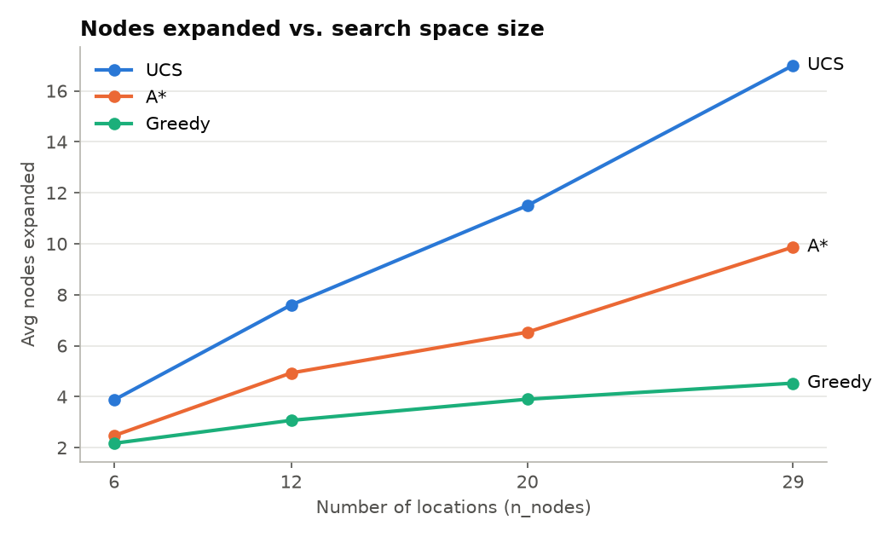
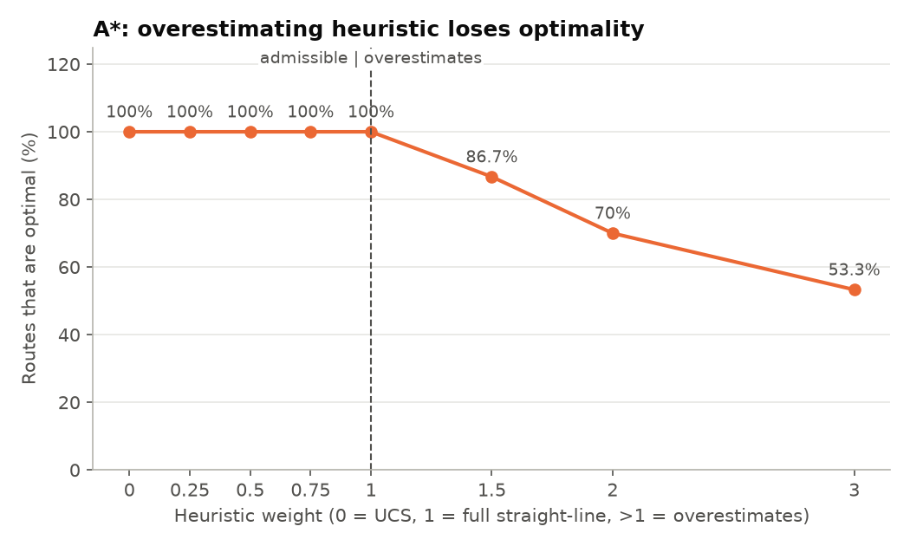

# MOTU: Mapping Ontario Tech University

MOTU is a route planner that compares three graph search algorithms on a map of the Ontario Tech campus and on randomly generated road networks:

- **Uniform Cost Search (UCS)**
- **A\***
- **Greedy Best-First Search**

It has a browser front end where you can build a map, pick a start and a goal, and watch each algorithm search. It also has an experiment harness that runs 30 trials per setting and writes CSV tables and charts.

  

---

## Key findings

All numbers come from [`results/summary.csv`](results/summary.csv) and are averaged over 30 random trials per setting.

| | UCS | A\* | Greedy |
|---|---|---|---|
| Finds the cheapest path | Always | Always | 43–53% of the time on medium-to-large maps |
| Nodes expanded (29-node map) | 17.0 | 9.9 | 4.5 |
| Extra cost compared with the best path | 0% | 0% | Up to 38% (skewed costs) |

- **A\* returns the same path cost as UCS every time but expands about 40% fewer nodes.** The heuristic is straight-line distance, and it never overestimates the real cost.
- **Greedy expands the fewest nodes, but it often picks a worse route.** The gap is largest when edge costs vary a lot.
- **If the heuristic is scaled up (weight above 1), A\* stops being optimal.** At weight 3.0 it finds the cheapest path in only 53% of trials, and its average cost is 7% higher than the best.

<p align="center">
  
  
</p>

---

## Quick start

```bash
git clone https://github.com/Toobam18/motu.git
cd motu
pip install -r requirements.txt
python app.py
```

Then open **http://127.0.0.1:5000** in your browser. Press `Ctrl+C` in the terminal to stop the server.

> On Windows, if `python` isn't recognized, use `py` instead.

---

## What you can run

| Command | What it does |
|---|---|
| `python app.py` | Starts the web front end at http://127.0.0.1:5000 |
| `python experiments.py` | Runs every experiment and writes CSV tables and charts to `results/` (takes about 10–20 s) |
| `python test_usc.py` | Runs 9 correctness tests for UCS |
| `python test_search.py` | Runs 15 correctness tests for A\* and Greedy |
| `python USC.py` | Runs UCS on the campus map in the terminal and draws the path with matplotlib |
| `python astar.py` | Runs A\* in the terminal |
| `python greedy.py` | Runs Greedy in the terminal |
| `python script.py` | Prints and draws a random graph |

---

## How it works

### Maps

- **Campus graph.** A hand-built map of 10 Ontario Tech locations (SIRC, ENG, LIB, UA, REC, the bus loop, and others). Edges are walking times in seconds. Some paths are indoor routes.
- **Random road networks.** These are made by `generate_random_graph` in [`script.py`](script.py):
  1. It places up to 29 nodes at random points in a square.
  2. It builds a minimum spanning tree (Kruskal with union-find), so the map is always connected.
  3. It adds edges between nearby nodes until the map reaches the target average degree.
  4. It sets each edge's cost to straight-line length × a detour factor of 1 or more. Because no edge is cheaper than its straight-line length, straight-line distance is an **admissible and consistent** heuristic.
  5. Optionally, it blocks a fraction of edges as obstacles.

  Every map is created from a single seed, so any run can be reproduced exactly.

### Algorithms

Each search has the same signature:

```python
result = search(graph, start, goal)
# -> {found, path, cost, nodes_expanded, time_ms, explored}
```

| File | Algorithm | Orders the frontier by | Optimal? |
|---|---|---|---|
| [`USC.py`](USC.py) | Uniform Cost Search | g(n): cost so far | Yes |
| [`astar.py`](astar.py) | A\* | g(n) + h(n) | Yes (with an admissible h) |
| [`greedy.py`](greedy.py) | Greedy Best-First | h(n): estimated cost to the goal | No |

---

## Experiments

[`experiments.py`](experiments.py) runs all three algorithms on the **same map and the same start/goal pair** in every trial. UCS's cost is used as the optimal baseline.

| # | What changes | Values | Chart |
|---|---|---|---|
| 1 | Graph size | 6, 12, 20, 29 nodes | [`1_size_nodes_expanded.png`](results/1_size_nodes_expanded.png) |
| 2 | Share of edges blocked | 0%, 15%, 30%, 45% | [`2_obstacles_nodes_expanded.png`](results/2_obstacles_nodes_expanded.png) |
| 3 | Cost distribution | distance, uniform, skewed, bimodal | [`3_cost_dist_greedy_gap.png`](results/3_cost_dist_greedy_gap.png) |
| 4 | Start-to-goal distance | near, medium, far | [`4_distance_nodes_expanded.png`](results/4_distance_nodes_expanded.png) |
| 5 | A\* heuristic weight | 0 to 3.0 | [`5_heuristic_strength.png`](results/5_heuristic_strength.png), [`5b_heuristic_optimality.png`](results/5b_heuristic_optimality.png) |
| 6 | Path density (average degree) | 2.5, 4.0, 5.5, 7.0 | [`6_paths_nodes_expanded.png`](results/6_paths_nodes_expanded.png) |
| 7 | Failure cases (maps can be cut off) | 30%, 50%, 70% of edges blocked | [`7_failure_success_rate.png`](results/7_failure_success_rate.png) |

The metrics are path cost, nodes expanded, run time, success rate, and how often the algorithm finds the optimal path. Raw per-trial data is in [`results/raw_results.csv`](results/raw_results.csv).

---

## Testing

```bash
python test_usc.py      # 9/9 pass
python test_search.py   # 15/15 pass
```

The tests cover:

- known shortest paths on the campus graph
- unknown start or goal nodes
- the case where the start is the goal
- unreachable goals
- UCS matching networkx's Dijkstra on all 45 campus pairs
- A\* matching UCS's cost on thousands of random start/goal pairs

---

## Project structure

```
motu/
├── app.py            Flask server and JSON API (/api/graph, /api/pair, /api/search)
├── static/
│   └── index.html    Browser front end
├── script.py         Campus graph, random graph generator, heuristic
├── USC.py            Uniform Cost Search
├── astar.py          A*
├── greedy.py         Greedy Best-First Search
├── experiments.py    Experiment harness that writes to results/
├── test_usc.py       UCS tests
├── test_search.py    A* and Greedy tests
├── results/          CSV tables and charts
└── requirements.txt  networkx, matplotlib, flask
```

networkx is used only to **store** the graphs. The graph generator and all three search algorithms are written from scratch.
